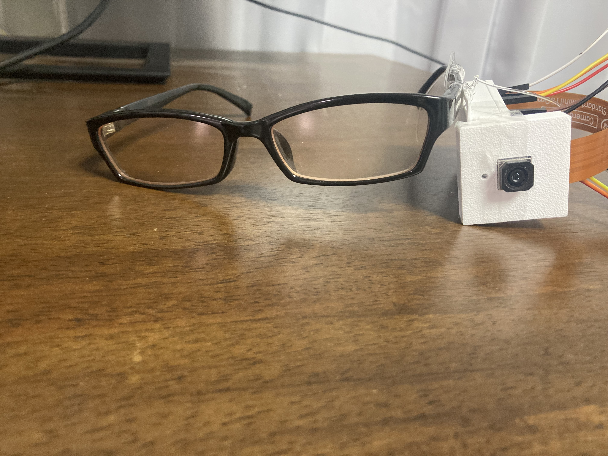
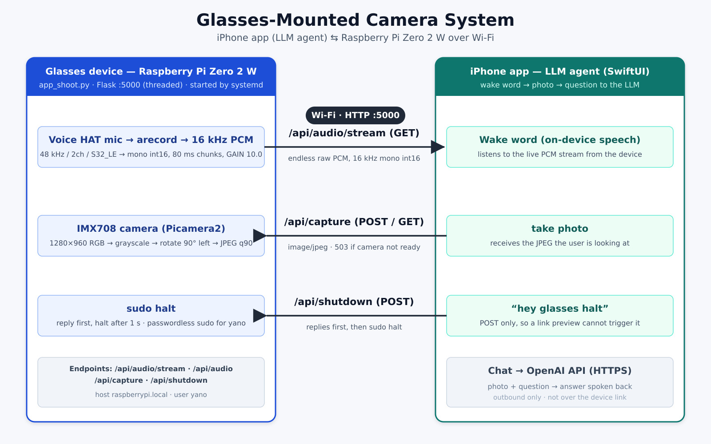

# wearable_raspberrypi_ocr

A camera and microphone that clip onto ordinary glasses, built with a Raspberry Pi.
Say **"hey glasses, what does this say?"** and the paired iPhone app takes a photo through the glasses and asks an LLM about what you're looking at.



**Demo video:** https://youtube.com/shorts/n7kPj4O048o

This repository is the **Raspberry Pi side** (server + 3D-printed enclosure).
The iPhone app is here: **[northwindapps/smartglasses_app](https://github.com/northwindapps/smartglasses_app)**

## How it works



1. The Pi streams microphone audio to the iPhone over Wi-Fi.
2. The iPhone transcribes it on-device and watches for the wake word.
3. On the wake word, the iPhone asks the Pi for a photo.
4. The iPhone sends the photo and your sentence to OpenAI and shows the answer.

## Hardware

| Part | Used here |
|---|---|
| Computer | Raspberry Pi Zero 2 W |
| Camera | InnoMaker IMX708 (autofocus) |
| Microphone | Google Voice HAT |
| Enclosure / arm | 3D-printed (`*.scad`, `*.3mf`, `*.amf`) |
| Power | USB mobile battery |

## API (`app_shoot.py`, port 5000)

| Endpoint | Method | Returns |
|---|---|---|
| `/api/audio/stream` | GET | Endless raw PCM, 16kHz mono int16 (`?format=wav` adds a WAV header) |
| `/api/audio?seconds=2` | GET | WAV of the last N seconds (max 10) |
| `/api/capture` | GET / POST | Grayscale JPEG from the camera |
| `/api/shutdown` | POST | Shuts down the Pi |

## Setup on the Pi

1. Enable the camera in `/boot/firmware/config.txt`, then reboot:
   ```
   camera_auto_detect=0
   dtoverlay=imx708
   ```
2. Install dependencies:
   ```bash
   sudo apt install python3-picamera2 python3-opencv python3-flask python3-numpy
   ```
3. Check your mic's device name with `arecord -l`, and update `ALSA_DEVICE` in `app_shoot.py` if needed.
4. Copy and run:
   ```bash
   scp app_shoot.py <user>@raspberrypi.local:~/
   python3 app_shoot.py
   ```
5. Optional: start at boot with systemd. See the `glasses.service` example in [memo.txt](memo.txt).

## Test from a laptop

```bash
curl -o photo.jpg http://raspberrypi.local:5000/api/capture
curl -o last3s.wav "http://raspberrypi.local:5000/api/audio?seconds=3"
curl -s "http://raspberrypi.local:5000/api/audio/stream?format=wav" | ffplay -
```

## Tips

- **Volume:** the Pi logs `rms` / `peak` every 5 seconds. Raise `GAIN` if it's quiet, and lower it if `CLIPPING` appears.
- **Wi-Fi drops on the Zero 2:** turn off Wi-Fi power save (see [memo.txt](memo.txt)).
- **Shutdown endpoint:** needs passwordless `sudo` for the user running the server.

## ⚠️ Security

The server has **no authentication**. Anyone on the same network can listen to the mic, take photos, or shut down the Pi.
Use it only on a network you trust, such as your own phone's hotspot.

## More

- [DESIGN.md](DESIGN.md): full design document
